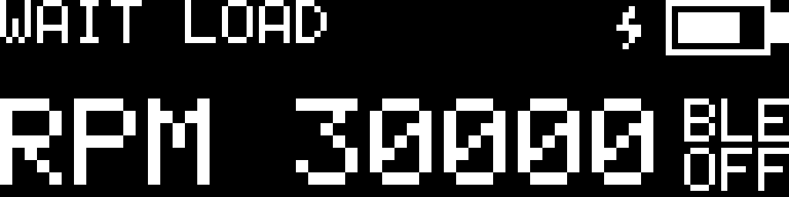

# 充電關閉藍牙兩行小字修改說明

以本次提供的 `BRD_BPX(3).zip` 為基礎，韌體版本為 V1.1。完整程式已整合於同名檔案，解壓後開啟 `BRD_BPX/BRD_BPX.ino`，不需另外貼入程式片段。

[修改] `BRD_BPX/brd_config.h` 第 74 行的 `BLE_OFF_WHILE_CHARGING` 預設值為 `0U`，首次使用時充電保留 BLE。下方兩行小字仍在使用者啟用充電關閉功能、且 BLE 已停止時顯示。已有 Flash 設定優先；將 API 參數 `04` 設為 `0` 後 SAVE 可套用到已有裝置。

## 顯示行為

| 狀態 | OLED 右下角 |
|---|---|
| 充電中、充電關閉 BLE 設定啟用，且 BLE 已停止 | [修改] 小字分兩行：上方 `BLE`、下方 `OFF` |
| BLE 已連線 | [保留] 原有藍牙圖示 |
| BLE 未連線，且未因充電停用 | [保留] 留白 |
| 充電中但關閉 BLE 設定停用 | [保留] 依連線狀態顯示 |

右上角電池及充電閃電圖示保留。RPM、MAX 與 HOLD 畫面均可顯示兩行小字。使用既有 5×7 字型、1 倍大小，文字位於 x111..127，上行 y16..22、下行 y24..30。[刪減] 原本帶斜線的藍牙停用圖示。設定保存後原有 200 ms 回覆期間，BLE 尚未停止時不提前顯示停用。

充電、設定或 BLE 停止狀態改變後，完成正在傳送的畫面即安排新畫面，不需等待固定 100 ms 更新週期。拔除充電後停用提示清除，依既有流程於可初始化時段恢復 BLE；再次連線後顯示原藍牙圖示。

## 完整檔案位置與替換位置

建議 Windows 專案資料夾：`C:\UserCode\ESP32\Arduino\Beyblade-RPM-Detector-Device\firmware\BRD_BPX\`。下列檔案以 ZIP 內完整同名檔案覆蓋，行號對應本次交付內容。

| ZIP 內完整相對路徑 | 起始行 | 新增／修改內容 |
|---|---:|---|
| `BRD_BPX/brd_oled.cpp` | 48 | [新增] 每幅畫面的充電停用狀態快照 |
| `BRD_BPX/brd_oled.cpp` | 468 | [修改] 分兩行繪製 `BLE` / `OFF` 小字；[刪減] 原斜線點陣 |
| `BRD_BPX/brd_oled.cpp` | 475 | [新增] 依充電、執行中設定及 BLE 啟動狀態判斷停用 |
| `BRD_BPX/brd_oled.cpp` | 502 | [修改] 充電停用時優先顯示兩行小字 |
| `BRD_BPX/brd_oled.cpp` | 659 | [新增] 停用狀態變化觸發下一幅畫面 |
| `BRD_BPX/brd_bbp.h` | 19 | [新增] `brd_bbp_is_started()` 唯讀宣告 |
| `BRD_BPX/brd_bbp.cpp` | 470 | [新增] 返回既有 `g_started`，只供主 loop 使用 |
| `BRD_BPX/tests/render_boot.cpp` | 12 | [新增] 配合介面的開機預覽替身 |

`BRD_BPX/BRD_BPX.ino` 不需添加程式。正式 `.ino/.cpp/.h` 保持同一層，文件位於 `BRD_BPX/`，預覽位於 `BRD_BPX/docs/`，既有主機測試位於 `BRD_BPX/tests/`。全部檔案與資料夾位置見 `FILE_MANIFEST.txt`。

## 程式渲染預覽

下圖由真正 `brd_oled.cpp` 的 128×32 framebuffer 最近鄰放大；右上角為充電與電池，右下角為兩行 `BLE` / `OFF`。此圖為程式渲染，非實機照片。

## 驗證

已重新執行 `python3 tests/run_host_tests.py`，五個既有主機測試與 BBP、I/O、主程式語法檢查通過。另渲染八種顯示狀態，確認充電停用、連線、保存回覆期間、關閉設定停用及拔除充電的畫面切換；MAX=30000 的文字與新圖示無重疊。

本次未執行 ESP32 target 編譯或實機燒錄，交付包含完整原始碼，未提供新 BIN。
